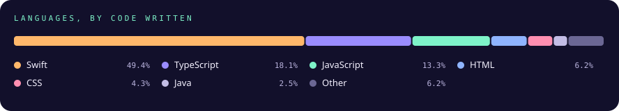

## Selected work

More at [zawalid.com/projects](https://www.zawalid.com/projects).

## Practice

## Stack

## Path

## Activity

## Writing

| Post | What it covers |
|---|---|
| [**Why I Built Lopper**](https://www.zawalid.com/blog/why-i-built-lopper) | AI coding agents leave git worktrees behind. A Mac app that proves each one is safe to remove first. |
| [**The Second Engineer**](https://www.zawalid.com/blog/the-second-engineer) | How I actually use Claude Code: the parts that work, and the parts that don't. |
| [**The Full-Stack Tax**](https://www.zawalid.com/blog/the-full-stack-tax) | Owning the whole stack is a superpower and a trap. What paying for it taught me. |
| [**From Idea to Production Alone**](https://www.zawalid.com/blog/from-idea-to-production-alone) | The order of operations, the ugly middle, and what "shipped" really means. |

## Contact

[zawalid.com](https://www.zawalid.com) &nbsp;/&nbsp; [LinkedIn](https://www.linkedin.com/in/zakan-walid/) &nbsp;/&nbsp; [walid.zakan@gmail.com](mailto:walid.zakan@gmail.com)
