

  

I build web platforms and AI features, then run them in production. More than a year on a product team shipping a B2B talent marketplace and an AI audit platform, plus products of my own: a LaTeX-to-PDF service, and two native macOS apps in Swift.

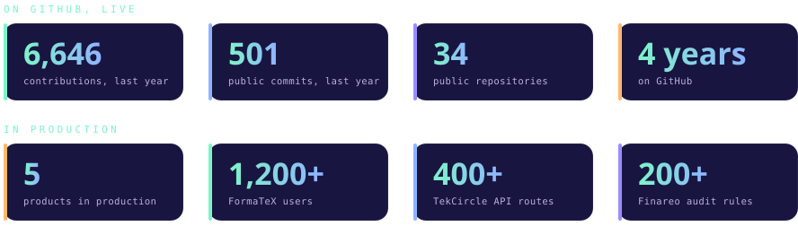

## Featured work

  <a href="https://github.com/Zawalid/Apropos">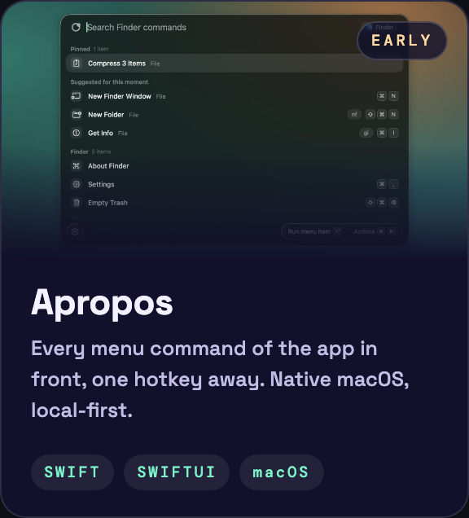</a>
  <a href="https://github.com/Zawalid/Lopper">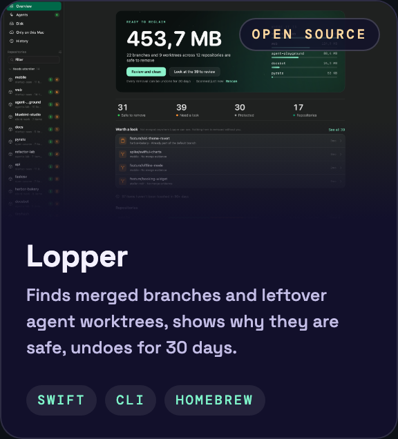</a>
  <a href="https://formatex.io">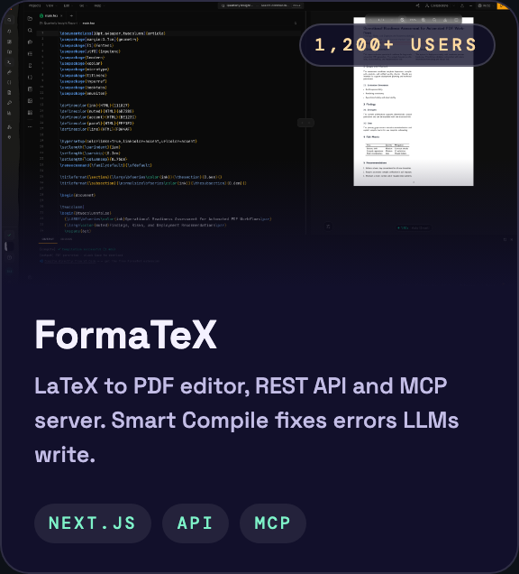</a>

  <a href="https://www.zawalid.com/projects/tekcircle">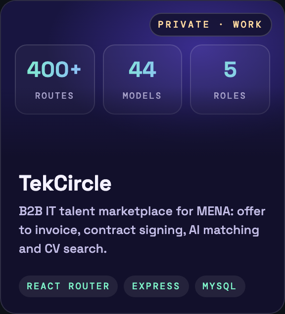</a>
  <a href="https://finareo.io">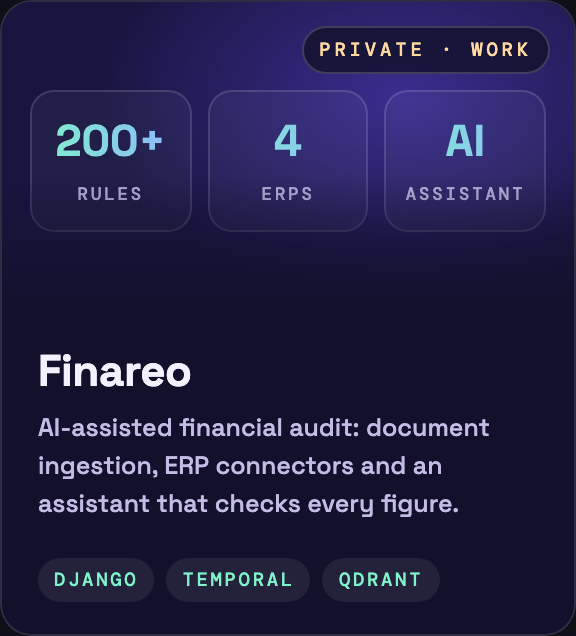</a>
  <a href="https://www.zawalid.com/projects">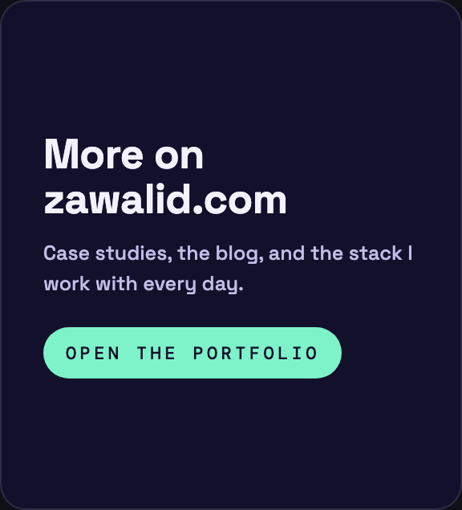</a>

## How I work

## Stack

## Path

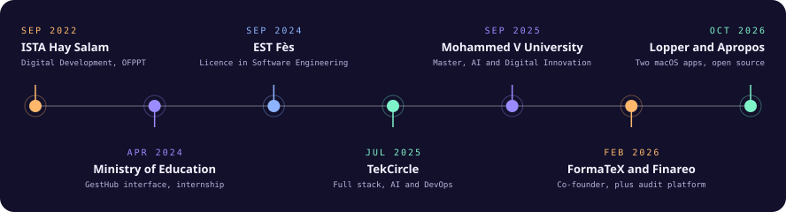

## Activity

## Writing

| Post | What it covers |
|---|---|
| [**Why I Built Lopper**](https://www.zawalid.com/blog/why-i-built-lopper) | AI coding agents leave git worktrees behind. A Mac app that proves each one is safe to remove first. |
| [**The Second Engineer**](https://www.zawalid.com/blog/the-second-engineer) | How I actually use Claude Code: the parts that work, and the parts that don't. |
| [**The Full-Stack Tax**](https://www.zawalid.com/blog/the-full-stack-tax) | Owning the whole stack is a superpower and a trap. What paying for it taught me. |
| [**From Idea to Production Alone**](https://www.zawalid.com/blog/from-idea-to-production-alone) | The order of operations, the ugly middle, and what "shipped" really means. |

## Now

- Building **Apropos** in the open, a native macOS command palette in Swift, and maintaining **Lopper**.
- Finishing a Master's in Computer Science, Governance and Digital Transformation at Mohammed V University, Rabat.
- Open to internships and junior roles in full stack, AI or DevOps, in Morocco or remote.

  
  <a href="https://www.linkedin.com/in/zakan-walid/">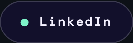</a>
  <a href="mailto:walid.zakan@gmail.com">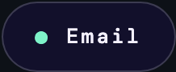</a>

